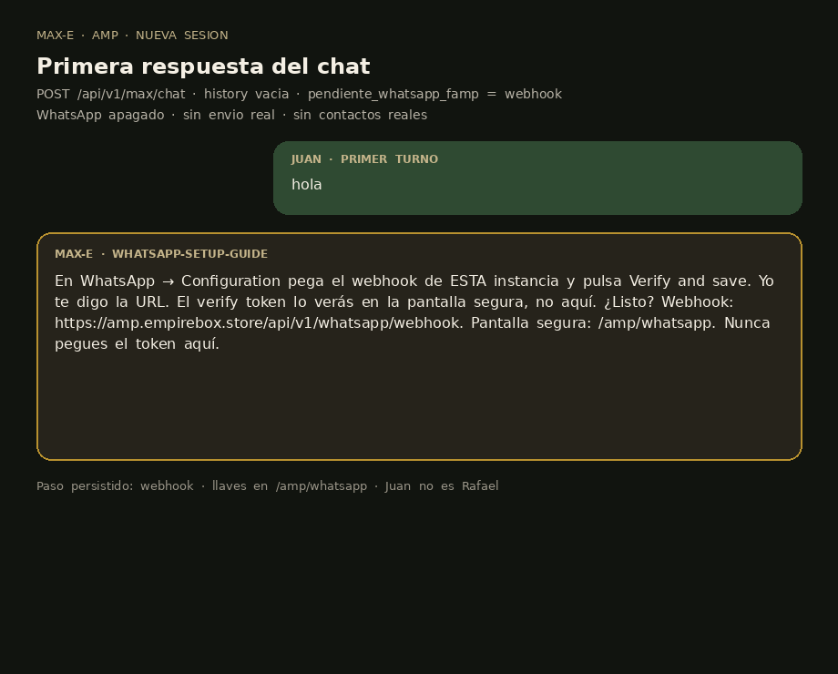

# Max-e: resume pending WhatsApp guide on new chat

**Instance:** Max-e (Juan) · base `family/amp-live-20261014`  
**Branch:** `cursor/maxe-whatsapp-guide-resume-f882`  
**Live send:** no · **Real contacts:** no · **Keys in chat:** no

## What changed

If `facts.json` has a `pendiente_*` WhatsApp item (example: `pendiente_whatsapp_famp`) and this instance’s WhatsApp channel is disabled, the family greeting and the first turn of a new Max-e session call `whatsapp_setup_guide` from the saved step. The current step is written back to facts so the next session resumes instead of restarting.

Spanish, one question. Tokens stay on `/amp/whatsapp`. Juan’s number does not alert Rafael.

## Tests

```
python3 -m pytest backend/tests/test_maxe_whatsapp_resume.py backend/tests/test_maxe_guides.py -v --tb=short
```

```
backend/tests/test_maxe_whatsapp_resume.py::test_new_session_first_reply_is_saved_step_and_persists PASSED
backend/tests/test_maxe_whatsapp_resume.py::test_stream_new_session_same_spanish_step PASSED
backend/tests/test_maxe_whatsapp_resume.py::test_frontend_style_first_turn_history_still_resumes PASSED
backend/tests/test_maxe_whatsapp_resume.py::test_enabled_whatsapp_does_not_hijack_greeting PASSED
backend/tests/test_maxe_whatsapp_resume.py::test_owner_greeting_is_the_step_question PASSED
backend/tests/test_maxe_whatsapp_resume.py::test_tool_persists_step_and_refuses_keys PASSED
backend/tests/test_maxe_whatsapp_resume.py::test_use_chat_opens_new_session_on_edition_guide PASSED
backend/tests/test_maxe_guides.py::test_chat_tools_confirm_and_never_echo_secrets PASSED
backend/tests/test_maxe_guides.py::test_juan_whatsapp_never_sends_rafael_help_alert PASSED
9 passed
```

## Real Max-e chat path (new session)

Temp `EMPIRE_DATA_DIR` with `pendiente_whatsapp_famp=webhook`. WhatsApp env unset (channel `disabled`). No model call.

`POST /api/v1/max/chat` and `POST /api/v1/max/chat/stream` with `message=hola`, empty history:

- `model_used`: `whatsapp-setup-guide`
- `step`: `webhook` (not `own_account`)
- First reply (Spanish, one question):

```
En WhatsApp → Configuration pega el webhook de ESTA instancia y pulsa Verify and save. Yo te digo la URL. El verify token lo verás en la pantalla segura, no aquí. ¿Listo? Webhook: https://amp.empirebox.store/api/v1/whatsapp/webhook. Pantalla segura: /amp/whatsapp. Nunca pegues el token aquí.
```

Facts after the turn: `pendiente_whatsapp_famp` value stays `webhook`.

Full JSON: `reports/2026-10-22_maxe_whatsapp_resume_chat.json`


